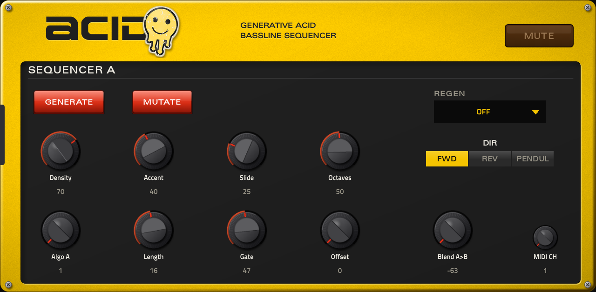
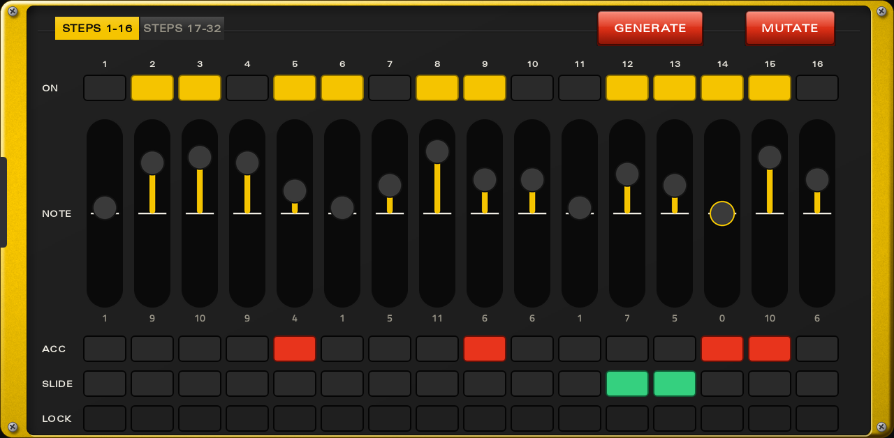
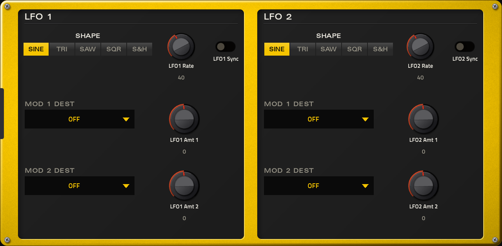

# Acid for MPC / Force

💬 Questions or feedback? Join the [Open MPC Discord](https://discord.gg/sRRysZSgu3).

> **MPC OS.** This release works on **MPC OS 3.x**. On MPC OS 2.x it loads and plays from the Q-Links, but its touchscreen
> page stays empty until a release with a compatible skin is published. The [catalog](https://sd88me.github.io/mpc-vst-plugins/)
> shows which MPC OS each release works on, and the installers warn before putting a 3.x-only plugin on a 2.x device.
> See [MPC OS 2.x vs 3.x](https://github.com/sd88me/mpc-vst-plugins#mpc-os-2x-vs-3x) in the main repo.

A TB-303-style acid bassline sequencer for the Akai MPC OS built-in plugin host. It generates two
bass lines, lets you blend between them, and plays them over MIDI into a synth track. Acid makes
no sound itself. It is a native VST2 plugin with a touchscreen skin and Q-Link control.



**Version 2.0.0** · GPL-3.0-only · by sd88me

## Use it
1. Add **Acid** to an instrument track from the plugin browser.
2. Acid plays through a MIDI output port named **Acid** (a second instance is **Acid 2**). On the track you want
   to hear it, set the MIDI input to that port and set **MIDI CH** to the channel that track listens on.
3. Press **GENERATE** on SEQ A, and on SEQ B if you want a second line, then start the transport.

The screen has six tabs: SEQ A, EDIT A, SEQ B, EDIT B, MOD and GLOBAL. The Q-Links follow the tab you are on.



### SEQ A and SEQ B
Each line is an independent sequencer of 2 to 32 steps. Both follow the MPC transport: every 16th is placed from the song position, so starting mid-song, looping or locating keeps Acid on the grid. The controls are the same
on both pages. Q-Links 1-8 turn the eight knobs in the order they appear (the grid left to right, top row then bottom), then GENERATE, MUTATE, BLEND, MIDI CH, REGEN and DIR.

| Control | What it does |
|---|---|
| GENERATE | Pick a new random seed and start a new pattern. Clears every locked step (see EDIT) |
| MUTATE | Nudge about 25% of the steps in place (rest/note, pitch), keeping the pattern recognisable. Repeat it to keep evolving. Mutated steps are locked, so they survive knob moves |
| DENSITY | Chance that a step is a note rather than a rest |
| ACCENT | Chance that a note is accented (louder) |
| SLIDE | Chance that a note slides into the next step, 303-style. A slide into a rest becomes a plain note |
| OCTAVES | How many octaves above the root the pitches can span, 1 to 3 |
| ALGO | 1 is the classic density/accent/slide model. Higher values blend in a second generator (non-repeating pitches, clustered runs of notes and rests, pyramid accents), up to 16 |
| LENGTH | Steps before the pattern loops, 2 to 32. It takes effect at once. GENERATE to fill a longer pattern with new steps |
| GATE | Note length as a fraction of a step. It is live, and held slides ignore it |
| OFFSET (A) / TUNE OFFSET (B) | OFFSET rotates which step plays without rewriting the pattern. TUNE OFFSET sets B's interval relative to A, ±24 semitones (+7 is a fifth above, -12 an octave below) |
| DIR | Forward, reverse, or pendulum (bounces off each end) |
| REGEN | Re-roll automatically every 1 to 32 bars, or off |
| MIDI CH | MIDI channel the line plays on |
| BLEND A>B | The same control as on GLOBAL |

DENSITY, ACCENT, SLIDE, OCTAVES, ALGO, LENGTH and SCALE reshape the playing pattern live from the current seed, so you can sweep them without losing its character. Returning a knob to the same value gives back the same pattern. Only GENERATE picks a new seed. Patterns saved with 1.0.x will sound different, because the same seed now maps to a different pattern.

### EDIT A and EDIT B
Each line has an edit page, next to its SEQ page, with 16 steps at a time. A yellow marker above the step numbers follows the playing step (on the bar you are viewing). The 16 Q-Links turn the 16 NOTE sliders. The STEPS 1-16 / STEPS 17-32 switch picks which bar of a longer pattern you see. Per step:

- **ON** switches the step between a note and a rest. A rest keeps its note, so switching it on brings the note back.
- **NOTE** is a vertical slider in scale steps from the root. 0 is the root, in the middle, and the slider reaches two scale octaves (14 steps) above and below it.
- **ACC** and **SLIDE** are independent, so a step can be both, as on a 303. GENERATE rolls them independently too.
- **LOCK** marks a step as hand-edited. A locked step keeps its note, accent and slide when DENSITY, ACCENT, SLIDE, OCTAVES, ALGO, LENGTH or SCALE reshape the pattern. Editing a step locks it. Tap LOCK to hand it back to the knobs.

Locks are saved with the project and cleared by GENERATE and REGEN.

### MOD
Two LFOs, each with two modulation slots. Per LFO: SHAPE (sine, triangle, saw, square or sample and hold), RATE (0.05 to 20 Hz) or, with SYNC on, a cycle of 1/4 note up to 16 bars locked to the song position. Each slot has a destination and an AMOUNT from -100 to +100. Destinations are DENSITY, ACCENT, SLIDE, OCTAVES, LENGTH, GATE and OFFSET on either line, plus BLEND.
Your knob values are never changed, so the knobs and the saved project show your own settings. The pattern follows the modulation, so the edit pages move while an LFO is on density, accent, slide, octaves or length. Q-Links 1-8 are LFO 1 and 9-16 are LFO 2.



### GLOBAL
| Control | What it does |
|---|---|
| SCALE | Scale both lines quantise to: Minor, Phrygian, Harmonic Minor, Minor Pentatonic, Dorian, Major, Phrygian Dominant, Locrian, Whole Tone, Hungarian Minor, Minor Blues or Chromatic (no scale) |
| ROOT | The key both lines play in, C to B |
| SWING | 16th-note swing from 50% (straight) to 75%, shared so the lines stay locked |
| JITTER | Chance per step of perturbing which step plays, never when: skip a step, repeat the last one, or jump to a random one. 0 is off |
| RESET ALL | Every 1, 2, 4 or 8 bars, snap both patterns back to step 1 together. Off lets patterns of different lengths drift as a polymeter |
| BLEND MODE | How A and B merge into one mono line, decided step by step (see below) |
| BLEND A>B | Sweeps from A to B, from -63 (A only) to +64 (B). How it acts depends on BLEND MODE |
| CV MODE | Sends both lines to a Force CV track for external CV/Gate hardware instead of a MIDI synth |

### Blend modes
Except in LAYER, A and B are merged into one mono line, so a synth on a single track plays one note at a time. The
other line is muted on each step, so notes never overlap. BLEND A>B sweeps in a fixed, evenly spread order, so the hand-over is
repeatable rather than random.

| Mode | Result | BLEND A>B |
|---|---|---|
| LAYER | Both lines play together as two voices, crossfaded by velocity. It is the only mode that isn't a single mono line | Fades the velocity from A to B |
| MORPH | Each step comes from A or B | -63 is A only, +64 is B only |
| SPLIT | Rhythm, slide and accent from A, pitch from B | -63 is A only, +64 is all pitches from B |
| FILL | A plays, and B fills A's rests | -63 is A alone, centre is the fill result, +64 is B alone |
| XOR | Plays only where exactly one line has a note: interlocking, syncopated | Same sweep as FILL |
| LOCK | Plays only where both lines have a note: sparse and tight | Same sweep as FILL |
| CHAIN | Call and response: A plays a full pass, then B answers with a full pass | Snaps to real pass ratios, 8:1 down to 1:1 and on to 1:8, plus A only and B only. A readout above the knob shows the current ratio |

Settings are saved with your project.

## What you need
- A first-generation MPC OS standalone device (32-bit ARM): Force, MPC Live / Live II, One, X or Key 61.
  Tested on a Force. Newer models are untested.
- **Root SSH access** to the device. Stock MPC OS doesn't offer it, so this is for modded units.
- Installing plugins this way is unofficial. Back up first and use it at your own risk.

## Install
1. Download `Acid-<version>-mpc-armv7.zip` from the
   [Releases page](https://github.com/sd88me/mpc-vst-acid/releases) and unzip it.
2. Copy the folder to the device: `scp -r Acid-2.0.0 root@<device-ip>:/tmp/`
3. Run the installer: `ssh root@<device-ip> sh /tmp/Acid-2.0.0/install.sh`

The installer **stops MPC** (save your project first), copies the plugin and skin, backs up
`MPC.settings`, registers the plugin and restarts MPC. Run it again to upgrade in place. Add `-y` to skip
the confirmation. `uninstall.sh` in the same folder removes it. `INSTALL.md` in the zip covers
installing by hand.


## Building from source
```
vst/build.sh     # armhf build in Docker: vst/build/acid.so, the skin, pluginlist-entry.xml
vst/test.sh      # offline x86 host test under ASan/UBSan; must print OK / PASSED
```
Both need `sd88me/mpc-vst-plugins` checked out next to this repo (`../mpc-vst`) or `MPC_VST=/path` set, for the
shared skin tools. Releases are built by the "VST release (draft)" GitHub Actions workflow using
mpc-vst-plugins' shared `vst-release.yml`.

- `src/`: the generation engine (`acid_core.c/.h`), vendored from `sd88me/force-acid` (see `src/VENDORED.md`)
- `vst/`: the plugin (`acid_vst.cpp`, MIDI out over ALSA seq), skin config (`vst.json`, `layout.conf`,
  `module.json`, `skin.css`, `fonts/`) and the build and test scripts

Acid is the MPC counterpart of the Force Shadow addon in `sd88me/force-acid` and uses the same engine.

## Credits
- **Pattern model:** the density / accent / slide / octave generator (ALGO 1) is a port of the TB-3PO model, via `schwung-tb3po` and the Phazerville TB_3PO applet.
- **Second generator:** ALGO values above 1 blend in a generator inspired by the Sting.amxd Max for Live device (non-repeating pitch draw, a random walk that clusters notes and rests, and the "VelPyra" accent shape).

## License
GPL-3.0-only. See `LICENSE`.
